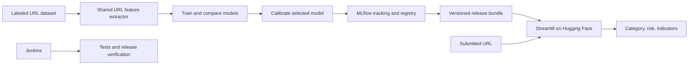

# PhishShield: One-Week Academic Project Plan

## Current implementation order

The user has chosen to build the local project first, including the URL analyzer, dataset preparation, model comparison, and MLflow tracking/registry. Jira setup, Hugging Face publishing, Jenkins setup, and the final academic report follow after this local phase. The academic rubric below remains the target for final review. When Jira is set up, track the real remaining work; do not backdate sprint history for work already completed. The available local Python environment is 3.13; the application supports Python 3.12 or newer and locks the versions actually tested.

## Academic review requirements

This plan targets the supplied 100-mark academic review. The confirmed team has four members, meeting the maximum of four. The four graded deliverables are mandatory; Jenkins remains part of the previously selected workflow, but its configuration must not delay these deliverables.

| Review requirement | Marks | Deliverable and evidence |
|---|---:|---|
| Jira Scrum Board | 25 | Actual backlog, assigned and estimated stories, seven-day sprint, workflow, genuine progress history, burndown, and retrospective |
| Project demo using MLflow | 25 | Three tracked candidate models, comparison metrics, charts/artifacts, registered winner, and a traceable release |
| Deploy in Hugging Face | 25 | Working public Space performing real inference with the exported model; URL, deployment revision, and screenshots |
| Softcopy report | 25 | Final PDF and editable DOCX containing real results, methodology, screenshots, references, contribution table, and project links |
| **Total** | **100** | Complete evidence for all four requirements |

The evidence checklist is a preparation aid, not an additional grading rubric supplied by the instructor. Do not promise marks or invent results.

### Team responsibilities

| Member | Main responsibility | Supporting responsibility |
|---|---|---|
| A | Scrum coordination, Jira, and report integration | Demo script and dataset documentation |
| B | Dataset, features, model comparison, and evaluation | Methodology and results sections |
| C | MLflow, model registry, release bundle, and Jenkins | Integration tests and experiment evidence |
| D | App, Hugging Face deployment, and visual polish | UI tests and deployment documentation |

These are work assignments, not four exclusive Scrum roles. Everyone contributes to the report and reviews another member's work. Replace A–D with the four actual names and academic identifiers when the team starts implementation.

### Jira Scrum workflow — 25 marks

Create a Scrum project named **PhishShield**, with project key **PSH** where available. Prefer company-managed Scrum for its reporting; use team-managed Scrum if permissions require it, enabling backlog, sprints, estimation, and reports.

- Epics: **Data & Modeling**, **MLflow & Quality**, **App & Deployment**, and **Scrum & Submission**.
- Columns: **To Do → In Progress → Review/Test → Done**. Keep Done as the final column.
- Sprint: one actual seven-day **Sprint 1**, with goal: “Deliver a reproducible URL classifier, MLflow demonstration, Hugging Face deployment, and academic report.”
- Each story: owner, epic, priority, acceptance criteria, story-point estimate, and evidence link.
- Estimate before starting the sprint; hold a ten-minute daily check-in and update actual progress.
- Definition of Done: acceptance criteria met, relevant tests pass, review performed where a teammate is available, and evidence attached.
- Finish with a sprint review and retrospective. Record unfinished work honestly.

Jira supports backlog ranking, estimates, and sprint planning. Story points are relative estimates, not hours. [Scrum backlog](https://support.atlassian.com/jira-software-cloud/docs/use-your-scrum-backlog/), [story points](https://support.atlassian.com/jira-software-cloud/docs/what-are-story-points/)

The following references are planned stories, not issues already created in Jira. The initial estimate is 39 points; confirm estimates against actual team capacity at sprint planning.

| Planned story | Owner | Points | Acceptance criteria |
|---|---|---:|---|
| Configure Jira and Sprint 1 | A | 2 | Epics, owners, estimates, sprint goal, and workflow visible |
| Prepare labeled URL data | B | 3 | Source/checksum documented; labels mapped; duplicates handled; domain-disjoint splits verified |
| Build shared feature extraction | B | 3 | Training and inference share features; parser and indicator tests pass |
| Compare and calibrate models | B | 5 | Three candidates compared; calibrated winner evaluated on untouched test data |
| Track experiments and artifacts | C | 5 | MLflow parameters, metrics, dataset metadata, evaluation charts, and importance chart visible |
| Register and export release | C | 3 | Candidate/champion aliases, manifest, model version, and reload parity verified |
| Build URL analyzer | D | 5 | Input validation, category, gauge, indicators, insights, and safety note work |
| Deploy Hugging Face Space | D | 3 | Public Space performs inference with the frozen release independently of laptop MLflow |
| Verify tests and Jenkins | C | 3 | Test reports published; release checks pass; deliberate regression fails |
| Prepare academic report | A | 5 | Editable report and PDF include real results, references, screenshots, contributions, and links |
| Rehearse and capture review evidence | A | 2 | All four graded deliverables demonstrated and final evidence package checked |

Capture the initial backlog, an active sprint during development, a representative story with acceptance criteria/activity, final board, genuine burndown, and retrospective. Attach source commits, MLflow run IDs, test results, and deployment links to relevant stories. If company-managed Scrum is available, include its Sprint Report. [Burndown guidance](https://support.atlassian.com/jira-software-cloud/docs/view-and-understand-the-burndown-chart/)

## Summary and project design

Build a polished cybersecurity demo that accepts a URL and displays:

- **Predicted category:** Potential phishing or Likely legitimate.
- **Risk score:** A 0–100 gauge with Low, Medium, and High bands.
- **Suspicious indicators:** Observable characteristics of the submitted URL.
- **Model evidence:** Comparison metrics, feature importance, and model version.

The first release analyzes URL text. Website content inspection is a documented future extension.

**Chosen stack:** Python 3.12, pandas, scikit-learn, Streamlit, Plotly, matplotlib, MLflow, pytest, and Jenkins. Use pinned dependencies and a reusable Python package; notebooks support exploration.

## Dataset and machine learning

**Dataset**

Use [UCI PhiUSIIL](https://archive.ics.uci.edu/dataset/967/phiusiil%2Bphishing%2Burl%2Bwebsite%2Bdataset), which contains 235,795 labeled URLs and permits reuse with attribution. Read only its raw URL and label columns; recompute features locally because its supplied feature table includes webpage-derived information.

Remap its original labels explicitly:

- Original `0` → project `1`, meaning phishing.
- Original `1` → project `0`, meaning legitimate.

Record the download source, checksum, original class counts, and cleaning results.

**Preparation and features**

- Apply conservative normalization: trim surrounding whitespace, lowercase scheme and hostname, and preserve path/query content.
- Remove duplicate normalized URLs; discard and report duplicates with conflicting labels.
- Use one feature extractor for training, inference, and indicator generation.
- Extract numeric features covering URL/hostname/path/query lengths, subdomain count, IP hosts, HTTPS, `@`, hyphens, digits, punctuation, query parameters, suspicious keywords, nonstandard ports, and punycode.
- Use a pinned Public Suffix List snapshot for domain extraction, with network updates disabled during inference.

**Evaluation design**

Split approximately **60% training, 15% validation, 10% calibration, and 15% test**, with seed `42`. Keep registrable domains disjoint across partitions; group IP hosts by IP. Save split assignments and verify both classes exist in every partition.

Compare:

| Model | Configuration for the first release |
|---|---|
| Logistic Regression | StandardScaler; `max_iter=2000` |
| Random Forest | 200 trees; maximum depth 20; minimum leaf size 2 |
| Histogram Gradient Boosting | 200 iterations; learning rate 0.1; 31 leaf nodes |

Use other scikit-learn defaults and seed `42` where supported. Include a majority/prior baseline. Avoid extensive hyperparameter tuning during the one-week build.

Select the winner by **validation average precision**, breaking ties using phishing recall at threshold `0.5`. Freeze the estimator, then fit sigmoid calibration using only the calibration partition. Evaluate the final pipeline once on the untouched test partition. [Calibration guidance](https://scikit-learn.org/stable/modules/calibration.html)

Report accuracy, phishing precision/recall/F1, average precision, ROC-AUC, false-positive rate, confusion matrix, Brier score, and a calibration plot. Report actual results without promising a particular accuracy.

## Demo behavior and inference interface

Create two Streamlit tabs: **Analyze URL** and **Model Insights**.

**Analyze URL**

Provide a clear input field, Analyze button, example buttons, loading state, result card, risk gauge, indicator list, and expandable URL breakdown. Highlight the effective hostname so users can recognize misleading subdomains or user-info syntax.

Require an explicit `http://` or `https://` URL with a valid hostname. Reject empty input, malformed URLs, invalid ports, unsupported schemes, and inputs exceeding 8,192 characters with actionable messages.

Use calibrated `predict_proba`, locating the phishing column through the model’s class labels:

`risk_score = 100 × P(phishing)`

| Output | Rule |
|---|---|
| Likely legitimate | Probability below `0.5` |
| Potential phishing | Probability at least `0.5` |
| Low risk | Score below 30 |
| Medium risk | Score from 30 to below 70 |
| High risk | Score at least 70 |

Calculate boundaries before rounding. Explain that the category uses a 50% threshold while the bands summarize the estimated risk.

**Indicators**

Display IP hosts, `@`, at least three subdomains, URLs longer than 75 characters, hostname hyphens, HTTP, and keywords such as `login`, `verify`, `secure`, `account`, `update`, and `password`.

For the TLD indicator, use training-set evidence: flag suffixes with at least 100 training examples and a phishing share of at least 70%. Label this **“TLD associated with phishing in this dataset.”** Keep this lookup separate from predictive features.

Indicators describe observed patterns; they do not automatically override the model.

**Model Insights**

Show the model comparison, held-out metrics, confusion matrix, calibration plot, and top ten features by permutation importance. Label the chart **Global feature importance** and log its PNG and CSV to MLflow. SHAP remains an optional later enhancement. [Permutation importance guidance](https://scikit-learn.org/stable/modules/permutation_importance.html)

**Internal interface**

Expose `analyze_url(url: str) -> PredictionResult`, returning the normalized URL, hostname, category, phishing probability, risk score, risk band, indicators, and model version. Keep this independent of Streamlit; no REST API is needed for version one.

Display:

> PhishShield is a decision aid, not a guarantee. Results reflect URL patterns; the website has not been inspected.

Use reserved example domains for demo buttons and display URLs as plain text. Submitted URLs are neither visited nor stored. [Reserved example domains](https://www.iana.org/help/example-domains)

## MLflow, Jenkins, and verification

**MLflow**

Run a local tracking server with SQLite metadata and local artifact storage. Log each candidate’s parameters, dataset checksum, split/feature versions, metrics, timings, and charts.

Register the complete calibrated inference pipeline as **`PhishShield`**, including its code dependencies, model signature, and harmless input example.

Use the workflow:

`candidate → validation checks → champion`

Set validation-status tags and preserve the previous champion for rollback. These aliases implement the selected release workflow; MLflow’s former Staging/Production stages are deprecated. [Registry documentation](https://mlflow.org/docs/latest/ml/model-registry/workflow/)

The local registry demonstration loads `models:/PhishShield@champion`. Resolve that alias to an immutable model version, then export a versioned release bundle with the complete fitted preprocessing/classifier/calibration pipeline, metrics, charts, regression fixtures, and manifest. The manifest records the registered model/version, source MLflow run ID, code revision, dataset checksum, feature version, thresholds/bands, dependency versions, and model SHA-256. Verify export/reload parity. The Hugging Face app loads this bundle locally; it must not depend on the laptop's MLflow server. Display the loaded version and report loading failures clearly.

For the academic demo, show one traceable release: candidate comparison → winning run and artifacts → registered champion → export manifest → the same model version/run ID in the hosted application's model-information panel. Keep MLflow's SQLite database and artifacts on the local machine and back them up for review.

**Jenkins**

Install Jenkins LTS through Homebrew. Configure a local inbound agent named `phishshield-local`, one executor, and a dedicated workspace; set controller executors to zero. Keep controller, agent, and MLflow access local to this trusted student project. [macOS installation](https://www.jenkins.io/download/lts/macos/)

Implement a Declarative `Jenkinsfile`:

1. Check out the repository.
2. Create a Python 3.12 virtual environment and install pinned dependencies.
3. Run pytest and produce JUnit XML.
4. Verify the exported release bundle and run inference regression checks.
5. Publish test results and archive release metadata and reports.

Enable manual builds and SCM polling every five minutes. Full training remains a separate local command; ordinary Jenkins builds do not retrain or promote models. [Jenkins reporting](https://www.jenkins.io/doc/pipeline/tour/tests-and-artifacts/)

**Required tests**

- URL validation and indicators, including IPv4/IPv6, user-info syntax, Unicode domains, and malformed input.
- Dataset label mapping, duplicate handling, and zero domain overlap.
- Probability bounds, phishing-class selection, category threshold, and risk-band boundaries.
- Prediction parity before and after model serialization.
- Registry registration, aliases, and reload using a temporary SQLite registry.
- Streamlit valid-input, invalid-input, and unavailable-model flows.
- Known-URL regression checks against the frozen release’s outputs.

Synthetic examples test parsing and indicators. Held-out labeled records measure predictive performance; regression snapshots measure software stability.

## Hugging Face deployment — 25 marks

Keep **Streamlit** and deploy it as a **Docker Space**. The built-in Streamlit SDK is deprecated; Hugging Face recommends the Docker SDK with a Streamlit template. [Streamlit deployment guidance](https://huggingface.co/docs/hub/en/spaces-sdks-streamlit)

The user will change the Hugging Face account later. Before deployment, confirm the replacement account or organization is eligible to create Docker Spaces. Current official rules require a paid personal or organization plan to create a Docker compute Space, even though CPU Basic has no hourly compute charge. Check the intended account's eligibility on Day 1; switch accounts before publishing. [Current creation rules](https://huggingface.co/docs/hub/en/spaces-overview)

Deployment package and behavior:

- Space title: **PhishShield**; public visibility for straightforward academic review unless college policy requires restricted access.
- Root README metadata: `sdk: docker` and `app_port: 7860`.
- Dockerfile: Python 3.12 slim image, pinned inference dependencies, installed application package, non-root UID 1000, and files owned by that user.
- Startup command: `streamlit run app.py --server.address=0.0.0.0 --server.port=7860 --server.headless=true`.
- Bundle `model.joblib`, manifest, test metrics, and feature-importance/calibration figures from the exact exported champion. Load and cache the model locally; verify its checksum and feature version at startup.
- Include inference code and its frozen suffix snapshot. Exclude raw datasets, training notebooks, Jenkins files, MLflow database, and training-only dependencies from the deployment image.
- Inference needs no Hugging Face token or remote MLflow server. Use a write credential only for publishing, outside committed files; do not put tokens in the model or app.
- Runtime writes are disposable; all required model assets come from the release package. Training stays local and no persistent storage is required.

Docker Spaces document the exposed port and UID 1000 runtime requirements. [Docker Spaces](https://huggingface.co/docs/hub/en/spaces-sdks-docker)

Acceptance checks: the public link works for a reviewer; fixed examples match local predictions within numerical tolerance; invalid input shows clear feedback; category/gauge/indicators/charts render correctly; model version/run ID match MLflow; and a restart works with the laptop's MLflow server stopped. Record deployment revision, model checksum, and screenshots. Open and exercise the Space before review because free hardware may sleep when inactive. [Space lifecycle](https://huggingface.co/docs/hub/en/spaces-overview)

## Academic report — 25 marks

Deliver **PhishShield_Report.pdf** and editable **PhishShield_Report.docx**, unless the college specifies another format. Use the college template if supplied; otherwise target approximately 15–20 body pages plus references and appendices. This page count is a planning default, not an instructor requirement.

Report structure:

1. Cover page: project title, actual team names/identifiers, institution, department, guide, and submission date; add college-required declarations or certificates.
2. Abstract, keywords, and table of contents.
3. Introduction, phishing problem, objectives, and URL-only scope.
4. Related work and cited background on URL-based detection.
5. Requirements, technology choices, architecture, and data flow.
6. Dataset source/license, label mapping, cleaning, features, and domain-disjoint evaluation design.
7. Logistic Regression, Random Forest, and Histogram Gradient Boosting methodology; selection and calibration.
8. MLflow experiment tracking, evaluation artifacts, model registry, and release traceability.
9. Application design, risk score, indicators, explainability, and safety note.
10. Hugging Face deployment, release version, operating constraints, and reproduction steps.
11. Jira Scrum process, backlog/sprint evidence, retrospective, and actual member contribution table.
12. Testing and real results: model comparison, held-out metrics, calibration/importance charts, Jenkins reports, and measured local/hosted inference behavior.
13. Discussion, limitations, conclusion, future webpage-inspection work, references, and appendices.

Include captioned evidence for the estimated Jira backlog, active/final board, genuine burndown, MLflow comparison, winning run/artifacts, registry aliases, hosted results, and Jenkins build. Use the same version/run identifiers across the report, MLflow, and hosted app. Add clickable Jira/repository/Space links and a requirements-to-evidence table with report section references. Describe actual contributions and unfinished work accurately.

Final report checks: correct front matter, generated contents/page numbers, readable screenshots/charts, consistent tables and citations, working links, and a visually checked PDF with no placeholders or invented values. Keep a brief recorded demonstration and screenshots as review evidence; they supplement the required live Hugging Face deployment.

## Seven-day schedule and completion criteria

Assume **4–6 focused hours daily**, basic Python familiarity, four members, and a review demonstrating Jira, local MLflow, and a live Hugging Face Space. No college report template or page limit has been supplied, so use the report defaults above until one is provided. Draft the report and capture evidence throughout the sprint.

| Day | Work | Deliverable |
|---|---|---|
| 1 | Team allocation, Jira backlog/sprint, Hugging Face account eligibility, environment, dataset | Started Scrum sprint, verified deployment route, report outline |
| 2 | Cleaning, domain splits, shared features, indicators, initial tests | Tested data/feature pipeline and genuine Jira updates |
| 3 | Three tracked models and baseline comparison; parallel UI development | MLflow comparison, working app shell, methodology draft |
| 4 | Calibration, final evaluation, importance chart, registry, export | Champion release, evaluation evidence, integrated local app |
| 5 | Hugging Face deployment, model parity checks, app polish | Live public Space and deployment evidence |
| 6 | Jenkins, integration tests, report assembly, evidence capture | Passing pipeline and complete report draft |
| 7 | Fix defects, verify deployment/restart, close sprint, rehearse, export report | Checked PDF/DOCX, Scrum evidence, and review-ready demo |

**The project is complete when:**

- A fresh environment can reproduce preparation, training, evaluation, and app startup.
- Valid URLs return results within one second after model loading on the demo laptop.
- Invalid inputs produce clear messages.
- Three model runs, final metrics, explainability artifacts, and registry aliases are visible.
- Jenkins publishes passing tests and fails when a deliberate regression is introduced.
- The repository includes setup instructions, dataset attribution, architecture, evaluation findings, limitations, screenshots, and a model card.
- A public Hugging Face Space runs real inference, survives a restart, and matches the exported local model with the laptop's MLflow server stopped.
- The Jira board demonstrates actual sprint progress, ownership, estimates, and completion evidence.
- A final PDF and editable DOCX contain real results and all four rubric evidence sets; no placeholders or invented measurements remain.
- A review presentation demonstrates Jira, MLflow, the live Hugging Face app, and the report. Jenkins is supplementary evidence.

**Future extension:** webpage inspection requires a separate content-feature pipeline, suitable labeled data, and isolated fetching with SSRF controls, redirect limits, and timeouts. It stays outside the one-week deliverable.

## Review presentation and submission checklist

Use an approximately eight-minute review unless the instructor specifies another duration:

| Time | Demonstration |
|---|---|
| 0–2 minutes | Jira: team ownership, planned backlog, actual sprint progress, one story's evidence, and burndown |
| 2–5 minutes | MLflow: three candidate runs, comparison, winning evaluation/artifacts, registered champion, and release manifest |
| 5–7 minutes | Live Hugging Face Space: synthetic example analysis, malformed input handling, model insights, and matching release identity |
| 7–8 minutes | Report: methodology/results, deployment evidence, contribution table, references, and limitations |

Demonstrate the saved real experiment runs; full-dataset training does not need to execute during the presentation. Jenkins is additional evidence if time allows.

Prepare a submission folder with final PDF, editable DOCX, a short index of repository/Jira/Space links, selected evidence screenshots, model card, and a brief recorded demo. Keep source code, model release, dependency locks, and reproduction commands in the project repository. Confirm reviewer access to all required links. Back up MLflow metadata/artifacts locally and verify the public deployment again before submission. Report results and contributions accurately; do not claim a board, deployment, or final report exists until it has actually been completed.
