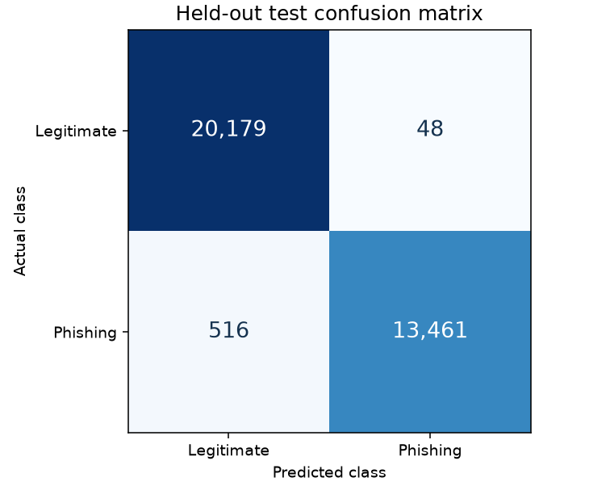
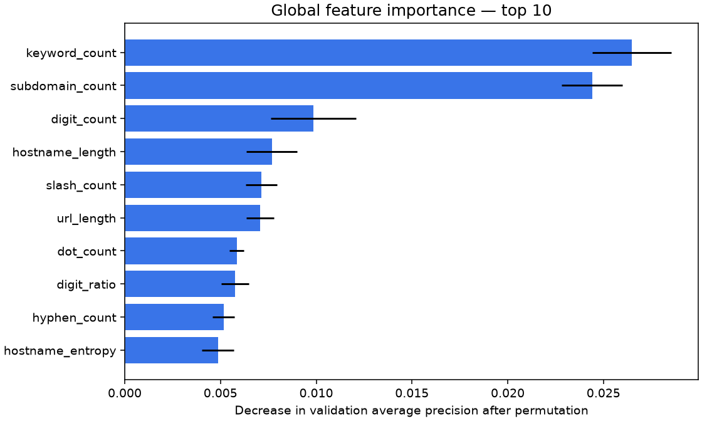

# PhishShield

**Phishing URL detection with an interactive Streamlit demo and reproducible MLflow experiments.**

PhishShield analyzes URL text, estimates phishing risk, and shows suspicious patterns alongside model evaluation evidence. It is an academic decision aid, not a guarantee of website safety. Submitted websites are never fetched and submitted URL history is not persisted.

## Features

- Calibrated 0–100 model gauge with Low, Medium, and High bands, plus an independent caution assessment.
- Offline brand-lookalike warnings for digit substitutions, typos, selected Unicode confusables, added brand text, and misleading subdomains.
- Indicators for IP hosts, `@`, many subdomains, long URLs, keywords, hostname hyphens, HTTP, punycode, and training-derived domain-suffix associations.
- Logistic Regression, Random Forest, and Histogram Gradient Boosting comparison.
- MLflow runs, native Dataset Inputs, evaluation artifacts, model registry, and `candidate`/`champion` plus academic `staging`/`production` aliases.
- Repeatable registry/export verification and an offline MLflow review evidence pack.
- Global permutation-importance chart, confusion matrix, and calibration/ROC/PR curves.
- Unit, inference, data-split, Streamlit, and MLflow integration tests; GitHub Actions configuration.

## Recorded benchmark

The current local release is **Random Forest, version 3**, using feature schema **1.1.0**. It uses the [Hannousse–Yahiouche dataset, version 3](https://data.mendeley.com/datasets/c2gw7fy2j4/3), which includes legitimate URLs with paths and queries. Results below come from **1,944 domain-disjoint test URLs**.

| Accuracy | Phishing precision | Phishing recall | Phishing F1 |
|---:|---:|---:|---:|
| 82.00% | 86.49% | 75.80% | 80.79% |

These are historical dataset results, not current-web accuracy. Domain-warning rules are evaluated separately and are excluded from these classifier metrics. See [MODEL_CARD.md](MODEL_CARD.md) and [the saved evaluation summary](docs/results/version-3.json).

**Why the dataset changed:** version 2's UCI corpus contained only HTTPS, `www`, root-page legitimate examples. Its 98.35% benchmark concealed severe false positives on ordinary paths. Version 3 uses a more varied corpus and reports its lower measured accuracy honestly. Earlier results remain in [the version 2 archive](docs/results/version-2.json) and MLflow; the cohorts differ, so their accuracy figures are not a like-for-like comparison.



## Quick start

Use Python **3.12 or 3.13**. The local build was tested with Python 3.13; CI is configured for both versions. From the cloned project folder:

```sh
python3 -m venv .venv
.venv/bin/python -m pip install -r requirements.lock
.venv/bin/python -m pip install --no-deps -e .
```

On Windows, use `python` to create the environment and replace `.venv/bin/` with `.venv\Scripts\` in commands below.

Download the documented dataset, train the candidates, and verify the release:

```sh
.venv/bin/phishshield download
.venv/bin/phishshield train
.venv/bin/phishshield verify
```

**Fresh clones require training:** raw data, serialized models, and local MLflow state are generated locally and are not committed to this repository. The setup and tests work without them; real predictions require a trained release.

The default download contains 11,430 records; cleaning leaves 11,411 usable URLs. For a smaller development run, use `phishshield train --max-rows 4000`. Use the full corpus for academic evaluation. Download provenance pins the mirror revision and both source-file checksums.

## Run the demo

Start the analyzer and MLflow in separate terminals:

```sh
.venv/bin/phishshield serve
```

Analyzer: <http://127.0.0.1:8501>

```sh
.venv/bin/phishshield mlflow
```

MLflow: <http://127.0.0.1:5001>. Port 5001 avoids macOS AirPlay's usual port 5000. Stop either service with Ctrl+C in its terminal.

Create a verified MLflow review and demonstrate alias promotion:

```sh
.venv/bin/phishshield mlflow-review --tracking-uri http://127.0.0.1:5001 --promote
```

The command records dataset lineage, checks native registry/export parity, and saves `reports/mlflow_review/index.html` plus `PhishShield-MLflow-Evidence.zip`. It records an academic review run and staging/production alias events. [Six-minute demonstration guide](docs/MLFLOW_DEMO.md).

The app reads `artifacts/release`; tracking uses the project-local `mlflow.db` and `mlartifacts`. These persist between launches. Retraining adds new runs and a model version. Use the reserved example buttons to demonstrate patterns without visiting submitted links.

```sh
.venv/bin/phishshield analyze 'https://www.example.com/'
```

## Methodology

1. Read only raw URL and `status` columns from the licensed Hannousse–Yahiouche corpus through a pinned public mirror. Recombine its original train/test files, discard their old partitions, and map phishing=1, legitimate=0. Webpage/external-service features are excluded.
2. Normalize URLs conservatively, remove duplicates/conflicting labels, and extract 30 numeric features using the same offline transformer as inference. Empty root paths and `/` receive identical features; other paths retain case and encoding.
3. Keep domain groups disjoint across approximate 60/15/10/15 training/validation/calibration/test partitions, seed 43.
4. Compare three models with balanced class weights and a prior baseline. Select by validation average precision, with phishing recall as tie-breaker.
5. Freeze the selected estimator and fit sigmoid calibration only on calibration data. Evaluate the final model on untouched test data.
6. Register the fitted pipeline, verify its exported checksum and prediction parity, and assign the `champion` alias.

The **model score** is `100 × calibrated P(phishing)`, with threshold 0.5 and bands below 30, 30 to below 70, and at least 70. The **caution assessment** is separate: a domain-lookalike warning displays “Suspicious domain — review required” with High caution, even if the model score is low. Its score is available under “View the unmodified model estimate.” Medium model estimates are presented as uncertain. Generic structural indicators provide context.

Neither spelling warnings nor catalogue domain matches prove phishing, ownership, or safety. The catalogue is a limited comparison reference and never lowers the model probability. No submitted website is opened.

Behavioral review of the reported failures is saved in [the version 3 summary](docs/results/version-3.json); the YouTube watch URL scores **3.91/100, Low**, while the two Google-like spellings trigger explicit review warnings. These cases are not an independently labeled accuracy benchmark and are not used for candidate selection or calibration.

For reproducing the older UCI experiment:

```sh
.venv/bin/phishshield download --dataset phiusiil
.venv/bin/phishshield train --data data/raw/PhiUSIIL_Phishing_URL_Dataset.csv --output artifacts/uci-comparison --seed 42
```

Training registers a new version and updates local aliases. Keep separate output folders when comparing sources; UCI results should not be presented as the default release's performance.



## Tests and CI

```sh
.venv/bin/python -m pytest -q
.venv/bin/python -m pip check
```

The suite uses small local fixtures and a temporary MLflow registry. It does not download the full dataset, visit example websites, or need a running server. The GitHub Actions [Tests workflow](.github/workflows/tests.yml) runs on pushes to `main`, pull requests, and manual dispatch, and saves JUnit test reports. Check hosted CI results in the repository's Actions tab.

## Project layout

```text
app.py                     Streamlit analyzer and model insights
src/phishshield/           Features, data preparation, training, inference, CLI
tests/                     Unit and integration tests
.github/workflows/         GitHub Actions test workflow
.streamlit/config.toml     Local theme and app settings
docs/                      MLflow demo, publishing guide, evaluation evidence
MODEL_CARD.md              Provenance, metrics, and limitations
PLAN.md                    Four-member academic project plan and rubric
requirements.lock          Pinned full environment
requirements.txt           Direct dependency pins
pyproject.toml             Package metadata and command entry point
```

## Academic review and publishing

Follow [the MLflow review guide](docs/MLFLOW_DEMO.md) to demonstrate candidate comparison, held-out evaluation, artifacts, registry aliases, and the matching app release. Back up `mlflow.db`, `mlartifacts`, and `artifacts/release` for the local review.

Use [the GitHub publishing guide](docs/GITHUB_PUBLISH.md) for the prepared initial repository. Jira, Hugging Face deployment, Jenkins setup, and the final report remain later phases in [the academic plan](PLAN.md). See [CONTRIBUTING.md](CONTRIBUTING.md) for team development.

## License and dataset attribution

Project code is licensed under the [MIT License](LICENSE). Both documented datasets retain their separate CC BY 4.0 attribution.

Hannousse, A. and Yahiouche, S. (2021). *Web page phishing detection*, version 3. Mendeley Data. DOI: [10.17632/c2gw7fy2j4.3](https://data.mendeley.com/datasets/c2gw7fy2j4/3). Collected May 2020. Downloaded via [pirocheto/phishing-url](https://huggingface.co/datasets/pirocheto/phishing-url/tree/1375d450d4540205ac11781b807249c9509739cd), revision `1375d450d4540205ac11781b807249c9509739cd`; both mirror partitions are recombined and only raw URL/status retained. Download metadata documents this transformation and source hashes.

Historical optional dataset: Prasad, A. and Chandra, S. (2024). *PhiUSIIL Phishing URL (Website).* UCI Machine Learning Repository. [Dataset and attribution details](https://archive.ics.uci.edu/dataset/967/phiusiil%2Bphishing%2Burl%2Bwebsite%2Bdataset).

URL-only models can miss convincing phishing URLs and flag legitimate complex URLs. This project does not inspect HTML, TLS certificates, WHOIS, DNS, redirects, or live reputation. Only load trusted model artifacts; the app does not accept uploaded model files.
